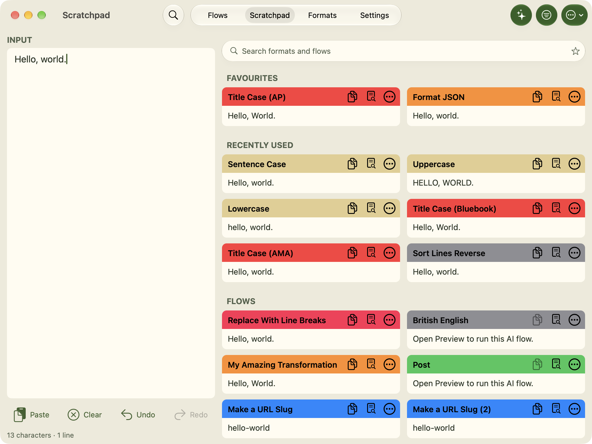
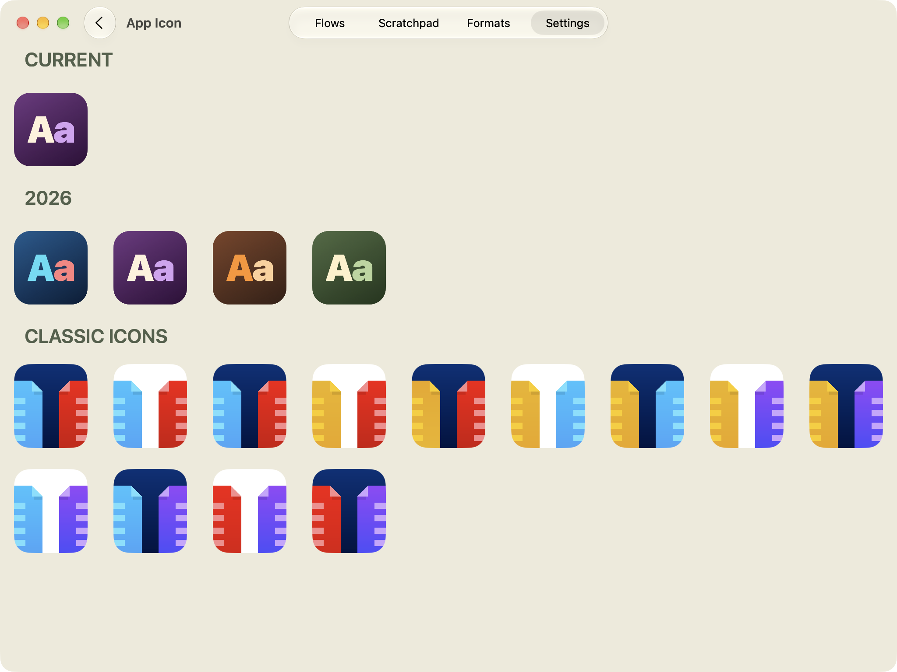
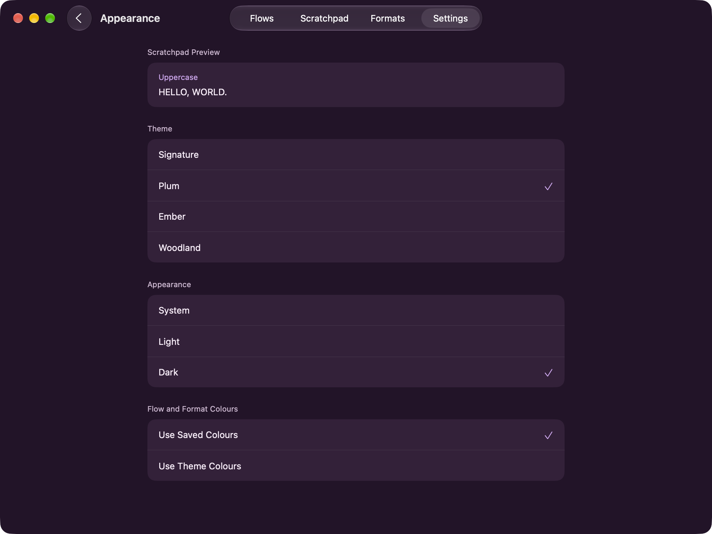
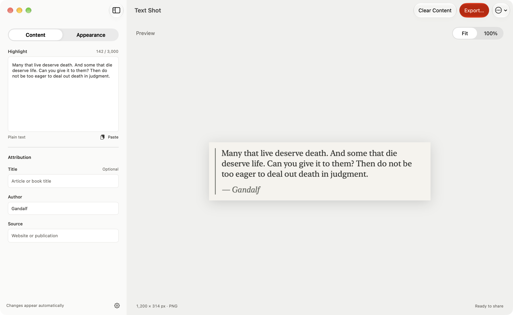
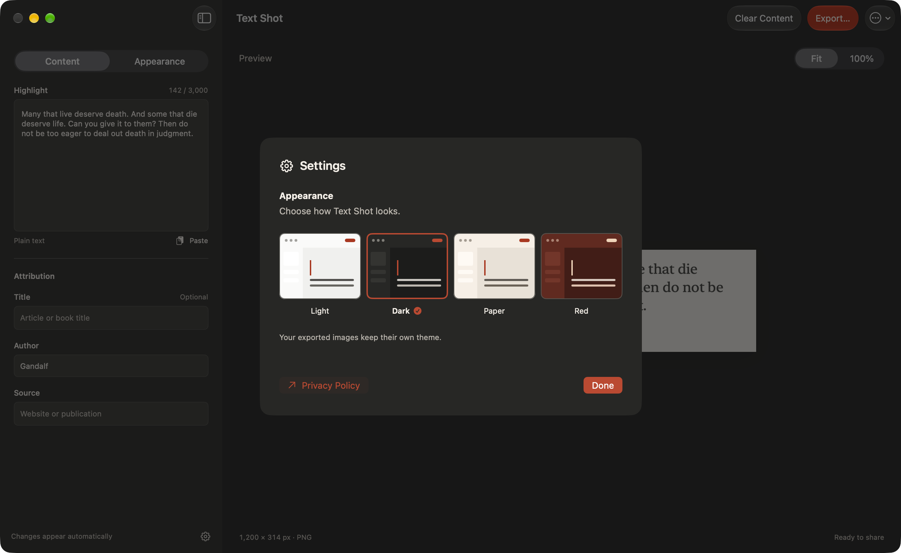
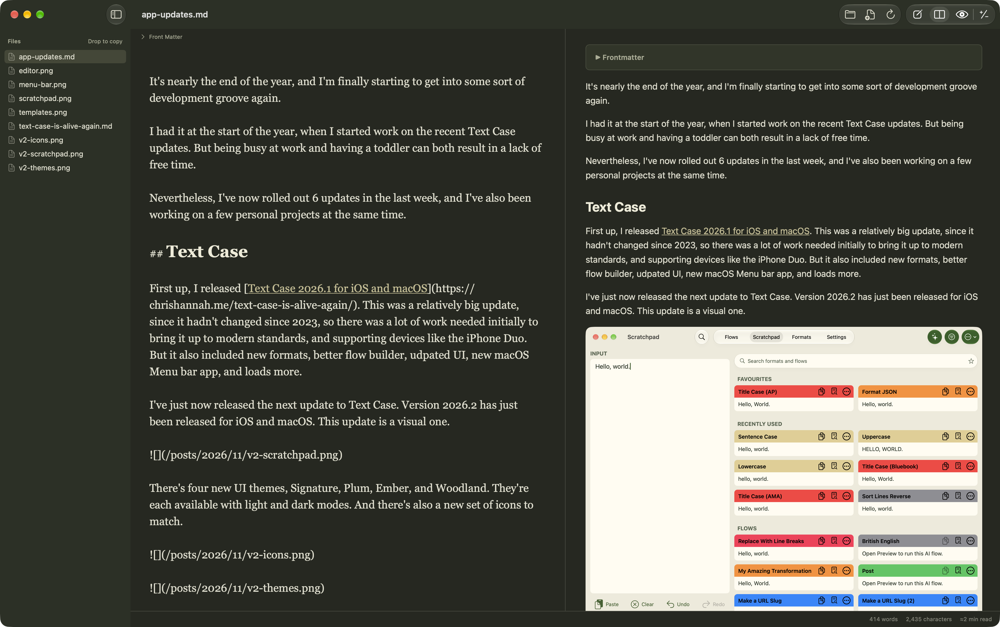
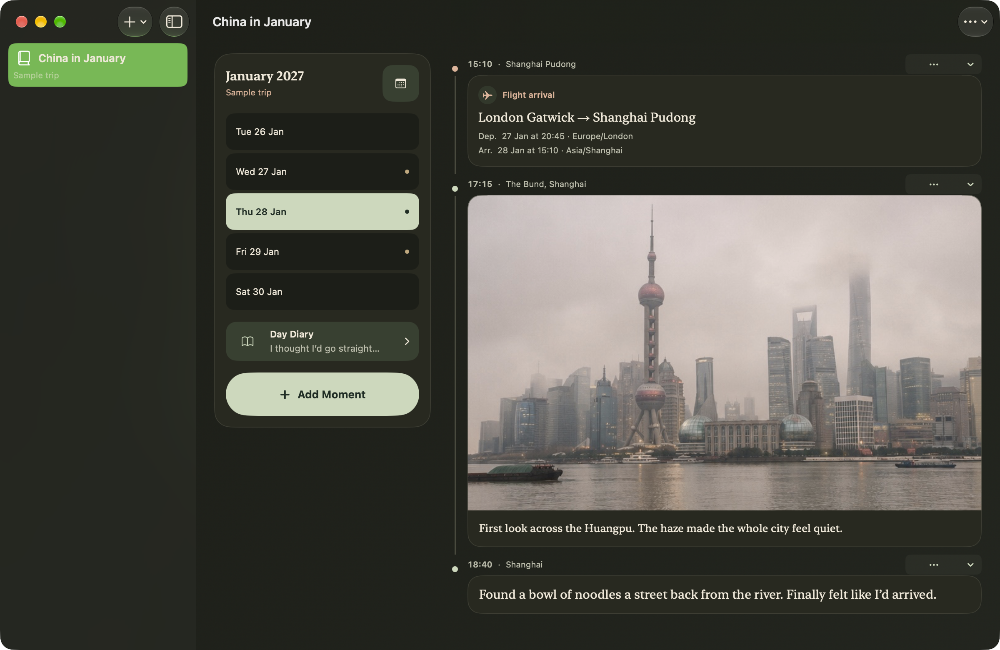
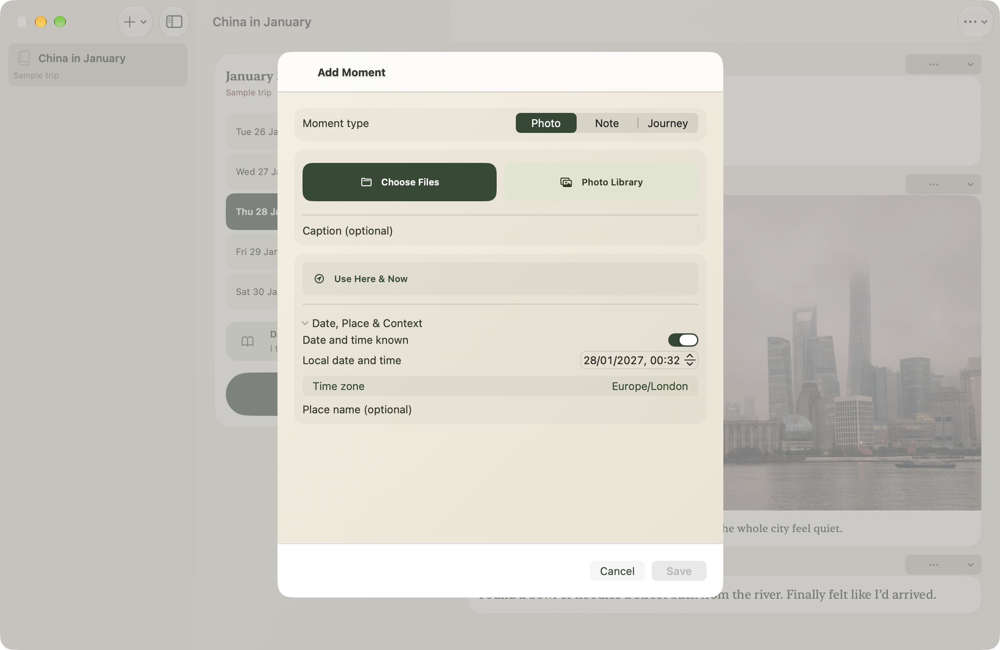

It's nearly the end of the year, and I'm finally starting to get into some sort of development groove again.

I had it at the start of the year, when I started work on the recent Text Case updates. But being busy at work and having a toddler can both result in a lack of free time.

Nevertheless, I've now rolled out 6 updates in the last week, and I've also been working on a few personal projects at the same time.

## Text Case

First up, I released [Text Case 2026.1 for iOS and macOS](https://chrishannah.me/text-case-is-alive-again/). This was a relatively big update, since it hadn't changed since 2023, so there was a lot of work needed initially to bring it up to modern standards, and supporting devices like the iPhone Duo. But it also included new formats, better flow builder, udpated UI, new macOS Menu bar app, and loads more.

I've just now released the next update to Text Case. Version 2026.2 has just been released for iOS and macOS. This update is a visual one. 

There's four new UI themes, Signature, Plum, Ember, and Woodland. They're each available with light and dark modes. And there's also a new set of icons to match.

With the last update full of functional tweaks, and this update with a visual revamp, I'm happy with the position of Text Case again.

[Website](https://textcase.app) | [iOS App](https://apps.apple.com/gb/app/text-case/id1407730596) | [macOS App](https://apps.apple.com/gb/app/text-case/id1492174677?mt=12)

## Text Shot

While I was working on Text Case, I thought I should also spend some time bringing Text Shot up to the same standard. Text Shot 2026.1 has also now just been release for iOS and macOS.

Most of the work is to get the UI working and feeling right on more devices. It's always been a relatively minimalistic application, but it now adapts better to larger devices such as the Mac, iPad, and iPhone Duo.

There's also a couple more appearance options for Text Shots, and new UI theme options.

[Website](https://chrishannah.me/text-shot/) | [iOS/macOS App](https://apps.apple.com/gb/app/text-shot/id6450152342)

## Pantry

The very app I'm writing this post with.

It's not perfect. But I wanted to start to work out what *I* wanted in a writing app. Not something that needed to be polished and released to the world, but something I could slowly build towards my own personal needs.

Right now, there's a Markdown editor, preview, git diff viewer, simple file explorer, theming, and quite a few typography settings I can tweak.

Next steps is probably better image support and publishing to my blog. But it's good having my own writing tool that I can personalise as much as I want.

## Lembas

I've had this idea for a while, and it's essentially a travel diary application. It's for when I want to record a trip digitally, and not just add a bunch of photos to my already endless photo roll.

It's all based on a trip timeline, with different types of moments along the trip. So far there are photos, notes, and journeys.

Everything is stored locally, there's no web service, no data leaving the device, and no privacy concerns. You can ask it to record your time and location when you save a moment, but it stays within the app. Unless of course, you choose to sync your trip with someone else. However, that works device to device, and doesn't require the internet at all. Not even an iCloud account.

I primarily built for myself for when I travel to China again next year, as I want to record everything, and then have an easy way to go through my trip and show family and friends when I'm back. 

But the reason I added the local sync feature for when we go away as a family. I'm sure we'll end up creating a shared album in iCloud after every trip, but I think this is also a fun way to memorise a trip, and have local synchronisation without wasting our mobile data usage.

