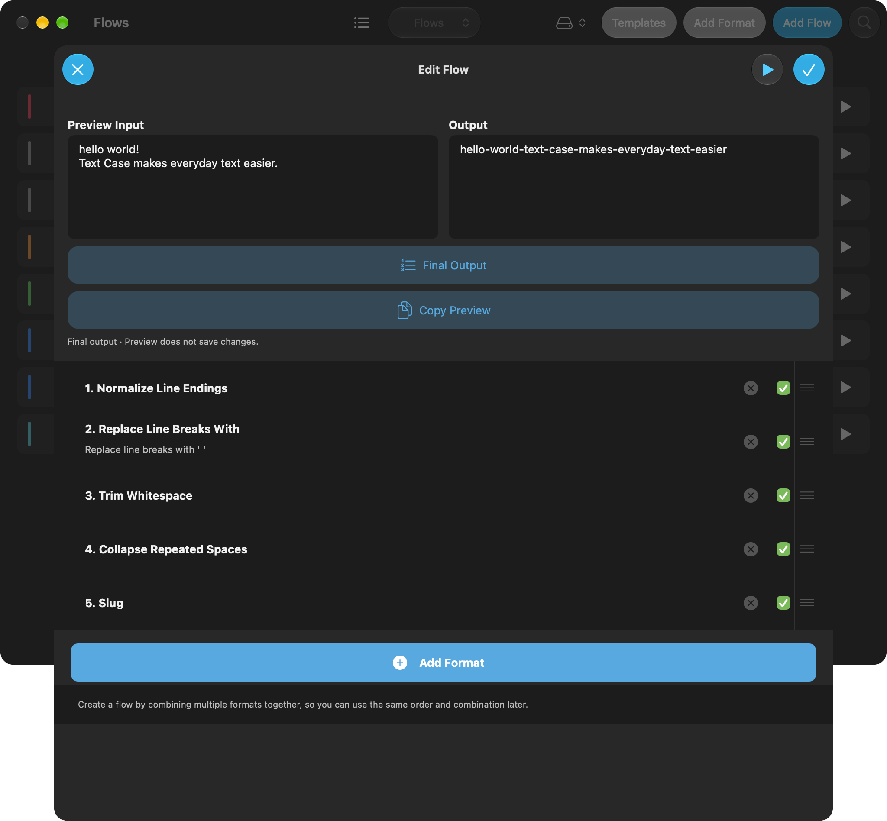
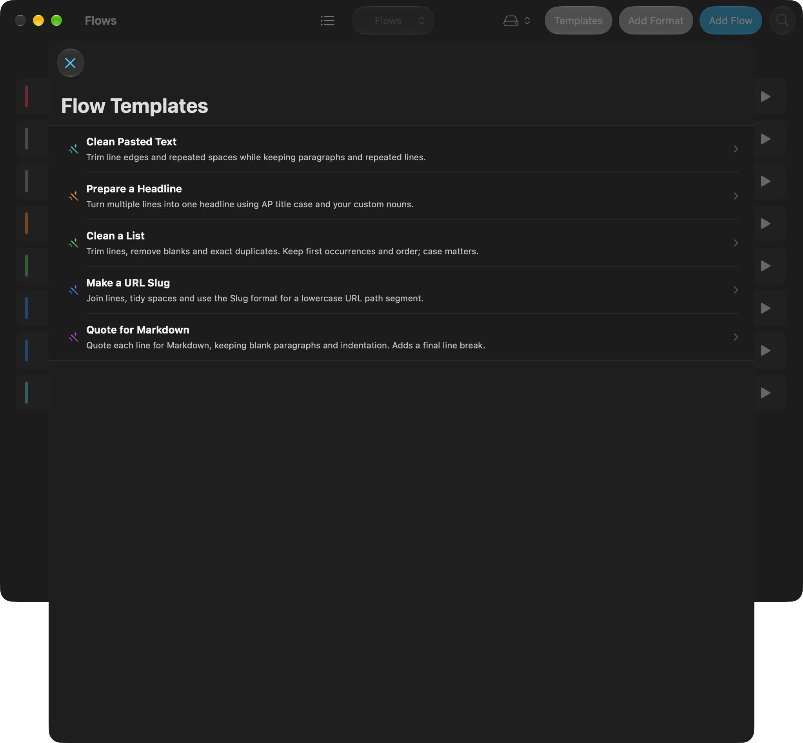
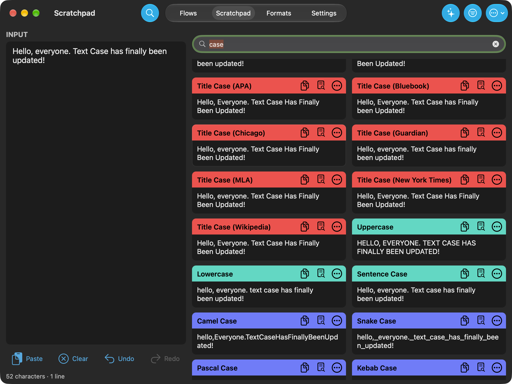
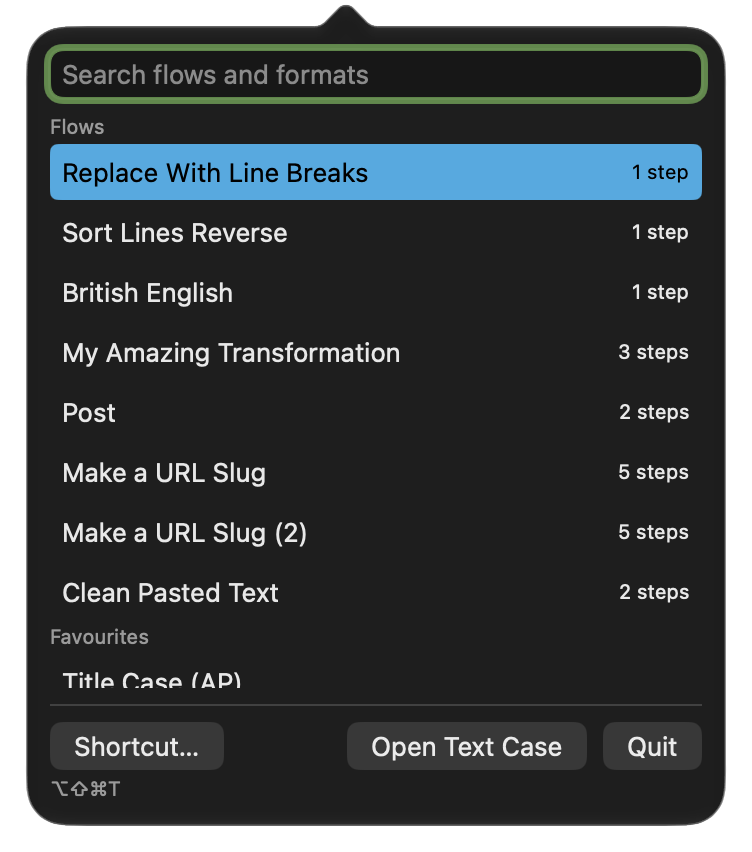

On the very last day of 2025, I wrote a post here with [my plans for the upcoming year](https://chrishannah.me/2026). When I talked about projects, I had two goals, the first being:

> Finish and release a revamped Text Case iOS and macOS app.

Well, it's mid-November, and that has finally been achieved.

Text Case version 2026.1 has finally arrived, with a massive internal overhaul and tweaks that hopefully no one will notice, along with quite a few new features.

## A better way to build a flow

First off, flow building has been improved, and it now should be easier for you to combine various formats to create your desired transformation. Previously, you would need to assemble the formats in the right order, and then run the flow to see the result. But now as you're building the flow, you can preview the current format, while quickly adding/removing formats, toggling them on/off, and reordering them.

If you're building something more complex, and need to debug certain steps, or want to make sure you've got everything working correctly, that should now be possible.

## Templates

You may want to start creating flows, but not know where to start. There are now five built-in templates to give you some ideas, and can give you something to build from.

## Flows as files

Flows can now be shared as files. You can open one from Files on iOS, double-click it in Finder on the Mac, or drop it onto the Flows list. Here are two to try:
- [Clean and Sort a List](https://textcase.app/downloads/clean-and-sort-a-list.textcaseflow)
- [Make a URL Slug](https://textcase.app/downloads/make-a-url-slug.textcaseflow)

## Scratchpad improvements

Scratchpad is the main place for quickly formatting text. Especially if you want to quickly see results from multiple flows/formats at the same time. It was already pretty good in my personal opinion, but there's quite a few handy additions that will make it just a bit more handy, such as:

- Format/flow searching
- Favourite formats/flows
- List/grid view mode.
- Chain formats by selecting "Use as input"
- Undo/redo chained transformations

## Now in your menu bar

You may not want to keep the main Text Case app open all the time, but when you want to quickly format some text, you can now do so from the menu bar. From there you can see your flows and favourite formats, or search through the whole list to find the one you want. Then after you choose the one you want, it will transform the text on your clipboard.

You can also do this just from your keyboard. **CMD** + **SHIFT** + **OPTION** + **T** will launch the menu bar app, and you can then navigate and choose a format by typing.

## Prompt-formats?

With Apple's on-device Apple Intelligence available, I thought it only made sense to integrate this into Text Case.

Now a format can be a simple prompt. Then every time you run, it uses the on-device model to transform your input. I think it could be handy for the *weird* formats that are hard to pin down to exact transformations without doing really crazy things.

For example, I’ve made for myself that "translates" American English to British English. You can [download the British English flow](https://textcase.app/downloads/us-to-british-english.textcaseflow).

## Getting the update

Text Case 2026.1 is available on the [App Store for iPhone and iPad](https://apps.apple.com/app/id1407730596) and the [Mac App Store](https://apps.apple.com/app/id1492174677). It requires iOS, iPadOS or macOS 26 or later. It’s a one-time purchase on each listing, and the update is free if you already have Text Case, including if you picked it up while it was free.

I’ve also rebuilt [textcase.app](https://textcase.app/). The new site has [the full release notes](https://textcase.app/release-notes/), more screenshots and a [press kit](https://textcase.app/press/).

If you’ve been using Text Case during the years I wasn’t updating it, I can't thank you enough for sticking around. And if you've created an interesting flow, I'd love to see it.

*P.S. There's another update on the way to Text Case with a whole new revamped theme system, and four quite different themes.*
